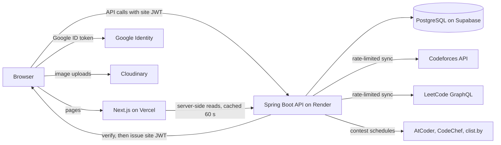

# Programming Club @ DAU

The platform of the Programming Club at Dhirubhai Ambani University (DAU). It
syncs members' Codeforces and LeetCode activity into leaderboards, weekly awards
and practice suggestions, and runs the club's events, contests, calendar and blog.
Sign-in is limited to `@dau.ac.in` Google accounts.

**Live site:** [programmingclubdau.vercel.app](https://programmingclubdau.vercel.app)

[](https://github.com/ProgrammingClub-DAU/website/actions/workflows/backend-ci.yml)
[](https://github.com/ProgrammingClub-DAU/website/actions/workflows/frontend-ci.yml)

> The API runs on Render's free tier and sleeps when idle. Public pages are
> served from a 60-second cache, so they load at once, but signing in after a
> quiet spell can take about a minute while the API starts.

| Layer | Technology | Hosted on |
| --- | --- | --- |
| Frontend | Next.js 16, React 19, TypeScript, Tailwind CSS 4 | Vercel |
| Backend | Java 17, Spring Boot 4, Spring Security, Spring Data JPA | Render (Docker, 512 MB) |
| Database | PostgreSQL, schema owned by 32 Flyway migrations | Supabase |
| Sign-in | Google Identity Services (ID tokens), then the site's own JWT | — |
| Images | Cloudinary, uploaded from the browser | Cloudinary |
| CI | GitHub Actions: backend build and tests, frontend lint and build | GitHub |

---

## What members can do

**Track progress**
- **Leaderboards** for Codeforces and LeetCode: rating, problems solved and
  contests, filterable by period and club role, with this week's
  **Weekly Honors** above the board.
- **Profiles** with rating history, the last 30 days of solves, level by topic
  and recent solves. Two members can be compared side by side.

**Practise and compete**
- **Smart practice:** ten problems a day, picked in the member's weakest topics
  at a rating where their estimated chance of solving is 40–70%, plus a "try
  again" list of problems they attempted and have not solved.
- **Club contests and championship:** standings of the club's Codeforces gym
  and group contests, synced every 15 minutes, with upsolve tracking and a
  season-long championship table.
- **1v1 battles (CP Bingo):** teams race to claim squares on a grid of
  Codeforces problems. Adapted from [hocln/bingo-cp](https://github.com/hocln/bingo-cp).

**Club life**
- **Calendar** of upcoming Codeforces, LeetCode, AtCoder and CodeChef contests
  alongside club events, with a subscribable feed (`/api/calendar/club.ics`).
- **Events** with registration, attendance, results podiums and reminder emails.
- **Blog** with Markdown and math, an admin review step and comments.
- **Hall of Fame, gallery and members directory.**

**Admins** get one dashboard for members, events, galleries, the Hall of Fame,
awards, blog review, club contests, the CP practice group and the health of every
sync job.

---

## How it works



### Syncing Codeforces and LeetCode

Scheduled jobs keep members' stats current. All times are IST.

| Job | Schedule | What it does |
| --- | --- | --- |
| Platform pipeline | Every 6 hours | Codeforces ratings → Codeforces submissions → LeetCode ratings → contest history → member scores |
| Club contest standings | Every 15 minutes | Contests that are running or recently ended |
| Contest calendar | Every 6 hours | Upcoming contests on four platforms |
| LeetCode solved totals | Daily, 00:05 | Baseline for "solved this week" counts |
| Member scores | Daily, 01:00 | Recomputes the scores behind the leaderboards |
| Rating snapshot | Monday, 00:00 | One point per member for the rating-history charts |
| Weekly awards | Monday, 00:30 | Weekly Honors |
| Codeforces problemset | Sunday, 03:00 | Problems, ratings and tags used by practice and 1v1 |
| Reminder emails | Hourly; 09:00 digest | Only when mail is configured |

Design decisions behind the sync:

- **One rate limiter per provider.** Every Codeforces call, scheduled or manual,
  takes a permit from one shared limiter (0.5 requests/s). LeetCode has its own,
  so a long Codeforces backfill never blocks it.
- **Batched lookups that survive a bad handle.** Ratings are fetched 100 handles
  per request, and Codeforces fails the whole batch if any handle does not exist.
  The sync reads the bad handle from the error and retries once without it. If
  the error does not name it, the batch is bisected, which takes about 14
  requests instead of 100.
- **Incremental, batched writes.** Each member's submissions are read from a
  stored cursor. Each page (500 submissions on a first sync) is written with
  batched `ON CONFLICT` upserts in one transaction, keeping each problem's
  earliest accepted submission.
- **No lost profile edits.** A sync touches only the columns it owns, and only
  while the member still has the handle the data was fetched for. A member who
  edits their profile mid-sync keeps their edit.
- **No transaction held across network calls.** The pool has three connections,
  so a rate-limited loop never holds one.
- **One run per job at a time.** A guard skips a job that is already running,
  and the admin Sync Health panel reports each job as running, healthy,
  degraded, failing or stale.
- **"Sync now" is bounded.** Member-requested refreshes go to one worker with a
  bounded queue, de-duplication and a 10-minute cooldown per member. Members still
  waiting for their first sync are queued again after a restart.

### Sign-in

The browser gets an ID token from Google. The API checks its signature, issuer,
audience (this site's client ID) and expiry, then the email domain and Google's
hosted-domain claim. It then issues the site's own JWT, valid for 30 days and
renewed on each visit. No passwords are stored. Roles are read from the database
on every request, so a role change applies at once.

### Fitting in free tiers

- **512 MB for the API.** The [Dockerfile](backend/Dockerfile) sets an explicit
  JVM memory budget (heap, Metaspace, code cache, thread stacks) and exits on
  `OutOfMemoryError` so Render restarts the process instead of routing traffic to
  a broken one. Production also uses lazy bean initialisation and a
  three-connection pool.
- **Pages that do not wait for a sleeping API.** Public pages read through a
  60-second stale-while-revalidate cache that never stores errors
  ([public-data.ts](frontend/src/lib/public-data.ts)).
- **Images resized at their source.** A custom image loader asks Cloudinary and
  Google for the right size and serves other images as they are, which keeps the
  site under Vercel's image-optimisation limit.
- **Keep-alive.** A scheduled workflow pings `/api/health` every 10 minutes.
  GitHub may delay scheduled runs, so this is best-effort.

---

## Measured results

| Change | Before → after | Conditions | Rerun |
| --- | --- | --- | --- |
| First Codeforces sync of a new member ([1ab364c](https://github.com/ProgrammingClub-DAU/website/commit/1ab364c)) | 21.8 s → 0.55 s | 1,500 solves, local PostgreSQL | Not scripted yet |
| Retries for one unknown handle in a 100-handle batch ([ab22f4d](https://github.com/ProgrammingClub-DAU/website/commit/ab22f4d), [1c57e58](https://github.com/ProgrammingClub-DAU/website/commit/1c57e58)) | 100 requests → ~14 (bisection) → 1 retry | Counted; 2 s per request at the rate limit | `CodeforcesSyncServiceTest` asserts exactly 2 calls |
| Admin page initial JavaScript ([0919687](https://github.com/ProgrammingClub-DAU/website/commit/0919687)) | 737 KB → 232 KB (−69%) | Production build | `npm run build` at `0919687^` and `0919687` |
| Public page load ([d302493](https://github.com/ProgrammingClub-DAU/website/commit/d302493)) | 1.4–2.1 s first visit → 15–60 ms after | Local Next.js against the production API | Manual |
| Production 500s on public endpoints ([027d632](https://github.com/ProgrammingClub-DAU/website/commit/027d632)) | 5 regression tests fail before the fix, pass after | Testcontainers PostgreSQL | `PublicEndpointsPostgresTest` at `027d632^` and `027d632` |

---

## Testing

- **Backend:** about 490 JUnit tests in 81 classes. Integration tests run on a
  real PostgreSQL through Testcontainers, and one test applies every Flyway
  migration to an empty database and validates the entities against it. Docker
  must be running.
- **Frontend:** ESLint and a production build on every push. Playwright smoke
  checks for layout and console errors live in `frontend/tests/` and are run by
  hand.
- **CI:** both workflows run on every push and pull request to `main`.

```bash
cd backend  && ./mvnw clean compile test -B
cd frontend && npm run lint && npm run build
```

---

## Run it locally

Requires Node.js 20+, Java 17+ and Docker. Sign-in needs a Google OAuth client
whose authorised origins include `http://localhost:3000`; see
[google_sign_in_setup.md](documents/google_sign_in_setup.md).

**1. Database**

```bash
docker compose up -d        # PostgreSQL on localhost:5432
```

**2. Backend** on `localhost:8080`. Spring does not read `.env` files, so export
the two required variables first. The app refuses to start without them.

```bash
cd backend
export JWT_SECRET="$(openssl rand -base64 48)"
export GOOGLE_CLIENT_ID="<your client id>.apps.googleusercontent.com"
./mvnw spring-boot:run
```

On Windows PowerShell, use `$env:JWT_SECRET = "..."` instead of `export`.
Flyway builds the schema on first start. API docs are at
`http://localhost:8080/swagger-ui.html` (disabled in production). Every other
variable is listed in [backend/.env.example](backend/.env.example).

**3. Frontend** on `localhost:3000`

```bash
cd frontend
cp .env.example .env.local   # set NEXT_PUBLIC_GOOGLE_CLIENT_ID to the same client ID
npm install
npm run dev
```

**4. Make yourself an admin.** Sign in once, then:

```bash
docker exec -it cpclub_postgres psql -U cpclub_user -d cpclub_db \
  -c "UPDATE users SET role = 'ROLE_ADMIN' WHERE email = '<you>@dau.ac.in';"
```

---

## Deployment

- **Frontend:** Vercel builds `frontend/`. Variables are listed in
  [frontend/.env.example](frontend/.env.example); they are inlined at build time.
- **Backend:** Render builds [backend/Dockerfile](backend/Dockerfile), which bakes
  in the `prod` profile. Variables are listed in
  [backend/.env.example](backend/.env.example).
- **Database:** PostgreSQL on Supabase. Hibernate only validates the schema; every
  change is a new migration in `backend/src/main/resources/db/migration/`.
- **Backups:** a weekly workflow takes an encrypted `pg_dump` once its two
  secrets are set. Backup and restore steps are in
  [DATABASE-BACKUP.md](documents/DATABASE-BACKUP.md).

---

## Repository layout

```
backend/     Spring Boot API, one package per feature (sync, codeforces, leetcode,
             contest, event, stats, practice, compete, auth, security, ...)
frontend/    Next.js app; see frontend/FRONTEND.md
documents/   Phase playbooks, roadmap, sign-in setup, backup and restore
.github/     CI, keep-alive, database backup and Dependabot
```

## Known limitations

- **One backend instance.** Job guards, the sync queue and rate limits live in
  memory, and scheduled jobs have no distributed lock. Running a second instance
  would need ShedLock or similar first.
- **1v1 battles** take solves reported by players' browsers and do not yet
  re-check them against Codeforces on the server.
- **CodeChef and AtCoder** stats are link-only on profiles, since neither has a
  public API for member data. Their contest schedules are scraped, with clist.by
  as a fallback.
- **Reminder emails** stay off until SMTP settings and `CPCLUB_MAIL_ENABLED` are set.

## Roadmap

Phase 4 plans a problem of the day with streaks, real-time lockout duels and
community threads, after a short list of cleanups. See
[project_roadmap_all_phases.md](documents/project_roadmap_all_phases.md). The
decisions behind Phase 3 are in
[phase_3_execution_playbook.md](documents/phase_3_execution_playbook.md); read
its Amendments section first.

## Contributing

Branch from `main`, run the checks under [Testing](#testing) for the side you
changed, and open a pull request. The team lead reviews and merges; no
self-merging and no force-pushing shared branches.

## Team

Built by the Programming Club @ DAU development team:
[Madhav Thesiya](https://github.com/madhavthesiya),
[Shane Christian](https://github.com/Shane07p),
[Raj Patel](https://github.com/Raj-Patel7807),
[Tanishq Shah](https://github.com/Tanishq7361),
[Gaurav Rathod](https://github.com/GauravRathod61) and
[Mahek Kanani](https://github.com/MahekKanani14).
